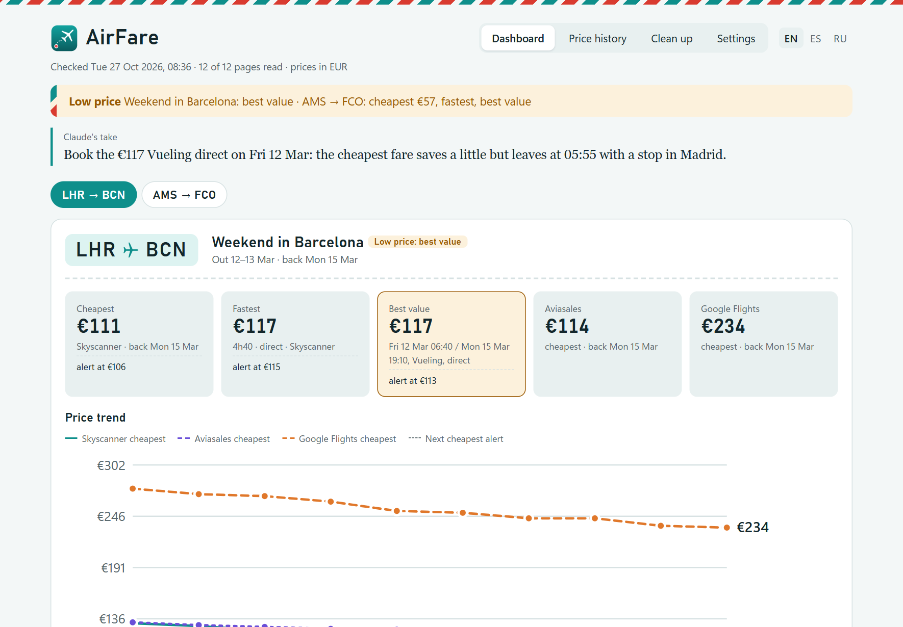
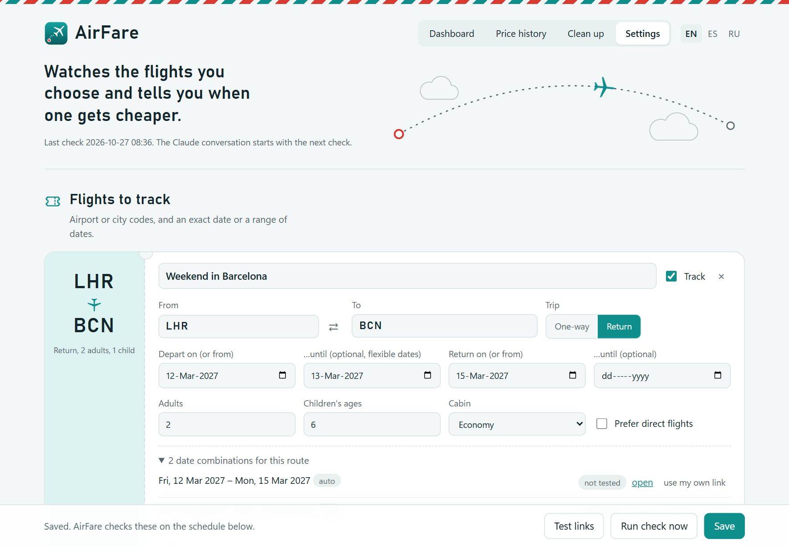
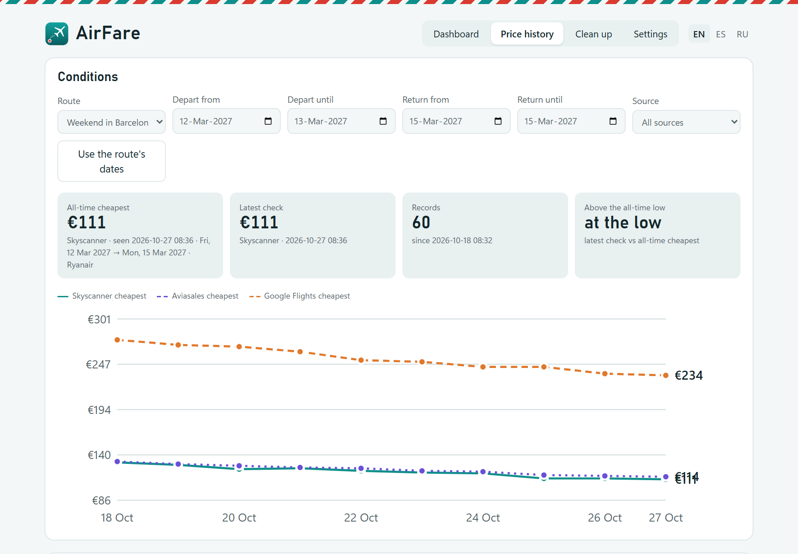
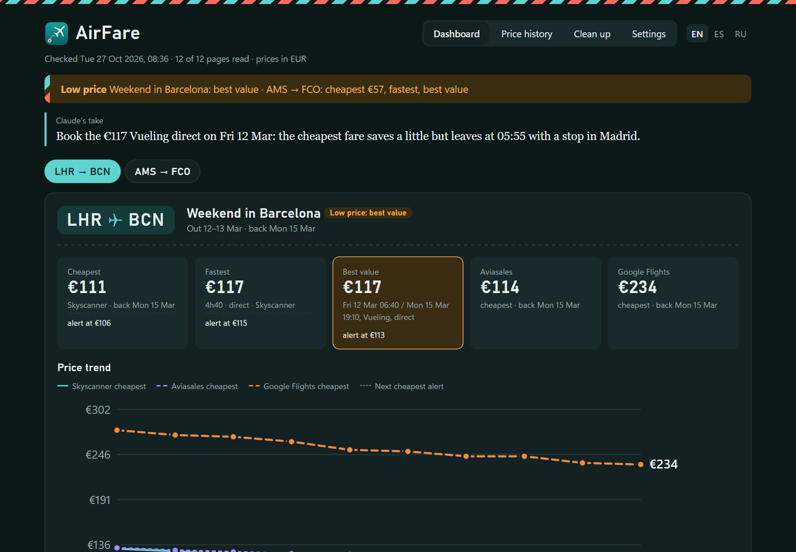

# AirFare

A flight-price watcher for Windows, macOS and Linux. It checks the routes you care about when your computer
starts (or every few hours), keeps the price history, and shows a **LOW PRICE** notification when a fare drops
to your target. Otherwise it stays silent.

- **Sources:** Skyscanner and Aviasales through a small extension in your own browser (Chrome, Edge,
  Brave, Opera or Firefox), and Google Flights through SerpApi. Each is opt-in.
- **Alerts:** three kinds (cheapest, fastest, best value), each with its own drop percentage or price
  limit, plus filters for very long trips and self-transfers.
- **Analyst, optional:** Claude, ChatGPT or DeepSeek reads every check, picks the best-value flight and
  writes a short take. With *No analyst*, AirFare's own rules alert on the cheapest and fastest fares.
- **Routes:** airport or city codes, exact dates or ranges, adults, children by age, cabin.
- **Currencies:** any of the 30-odd the European Central Bank publishes, plus the ruble; every price is
  converted and compared in yours.
- **Pages:** a dashboard with one tab per route and a price trend, a price history with CSV export,
  Settings, Clean up. Light and dark, in English, Spanish and Russian.
- **Local:** everything stays on your computer, in one `data` folder. No account with AirFare, no telemetry.
- **Systems:** Windows 10 and 11, macOS and Linux (see *Install*).

| Dashboard | Settings |
|---|---|
|  |  |
|  |  |

*(Screenshots from a demo configuration: made-up routes and prices.)*

The interface switches language with EN · ES · RU at the top right of any page, at any moment, and the
analyst writes in the language you picked.

## Price sources

Pick any of them in **AirFare Settings**:

- **Skyscanner, through the AirFare browser extension.** At startup, AirFare asks the extension in
  your everyday Chrome, Edge, Brave, Opera or Firefox (pick which in Settings) to open the result pages
  in a minimized window. The extension waits about 20 s, reads the prices, and closes the tabs it opened. It never
  closes your own tabs or windows; a tab you open in AirFare's window stays. If the browser isn't
  running, AirFare starts it minimized, and when AirFare's tabs are all it has open, a small "Price
  check done" page stays instead of closing the browser, so it keeps your previous tabs to restore
  rather than the flight pages. Because it's your normal browser, any robot check is an ordinary one:
  the window comes up so you can solve it yourself. AirFare never solves it for you. Note that automated
  visits are against Skyscanner's terms, so keep the number of pages small.
- **Aviasales.ru, through the same extension.** AirFare builds the Aviasales search for each date pair
  (`/search/BCN1503LON18031`: airports, dates, cabin, adults) and the extension opens it in the same
  minimized window as the Skyscanner pages. It reads Aviasales' own results feed, waits for the search
  to finish, and closes those tabs too. Aviasales shows rubles; AirFare converts them (see Currency).
  City codes become IATA city codes (LOND → LON), and only dates within the coming year are searched.
- **Google Flights, through [SerpApi](https://serpapi.com/google-flights-api)** (optional). This runs
  fully in the background with no robot checks. You need a free API key (about 250 searches a month),
  and each date combination uses one search per check. For return trips the price is the round-trip
  total, and only the outbound flight is listed. API keys can be saved on their own with their **Save
  key** button, before any flight is set up.

No source is on until you tick it. Skyscanner's and Aviasales' terms of use don't allow automated visits;
AirFare reads their pages through your own browser, never hides that it is a program, and never solves a
robot check for you. Tick those sources only if that is acceptable to you, and never pass the data on.
AirFare caps how many of their pages it opens; see *Responsible use* below.

## AI analysts

- **Claude with an Anthropic API key** (console.anthropic.com), billed per check to that key. This is the
  default and the path Anthropic's terms intend for a tool like this. **Claude with a Claude account** (Pro or
  Max, through the Claude Code CLI bundled with AirFare, **Log in to Claude**) is also offered: Anthropic's
  terms are written for your own use of Claude Code, so using a subscription from another program is your
  responsibility.
- **ChatGPT with a ChatGPT account** (Plus, Pro, Business and similar), through OpenAI's Codex app, which you
  install yourself with OpenAI's own installer (`irm https://chatgpt.com/codex/install.ps1 | iex` in
  PowerShell; `curl -fsSL https://chatgpt.com/codex/install.sh | sh` in a terminal on macOS and Linux) and
  sign in with **Log in to ChatGPT**. AirFare runs `codex exec` (and `codex exec resume
  <thread>` to continue the conversation) in an empty folder of its own, read-only and without approvals,
  and reads Codex's JSON events. Checks count against the ChatGPT plan; check OpenAI's terms for that use.
- **ChatGPT with an OpenAI API key**, through the Responses API (`gpt-6.1-terra` by default; Luna, Sol and
  Astra too). Nothing is stored at OpenAI (`store: false`); the conversation is kept in `data/openai`.
- **DeepSeek** with an API key; the conversation is kept in `data/deepseek`.
- **No analyst.** AirFare still records every price, alerts on the cheapest and fastest fares and draws the
  dashboard, with no AI account at all. The best-value pick, the analysis text and the lowest-price lookups
  need an analyst, so the best-value alert kind stays off.

Lowest-price lookups can use any of the analysts; both ChatGPT options search the web.

## Dashboard and Clean up

The dashboard has one tab per route. A route that's no longer in the latest check (you turned it around,
changed its airports, travellers or cabin, or removed it) keeps its last check on its own tab, marked as
earlier, until you remove it. Changing a route's direction, airports, trip type, travellers or cabin makes it
a new route with its own alert references and history; changing only its dates doesn't.

**Clean up** (the fourth tab) shows what AirFare has kept and removes parts of it; every button says how
much it will delete before you press it:

- price history by route, source, age, or trips that already happened;
- dashboard routes (single ones, or every earlier route);
- alert references (each kind starts again from the next check);
- lowest-price lookups, old check reports, and the log;
- the analysts' conversations (start fresh);
- automatic clean-up after every check (keep price history, reports and earlier dashboard routes for N days);
- **Start over**: all check history at once. Routes, settings, API keys and analyst accounts always stay.

## Currency

Pick Euro, Pound, Dollar or Ruble in **Currency**, or any other currency the European Central Bank publishes
a rate for (Swiss franc, złoty, koruna, krona, lira, yen, Australian or Canadian dollar and so on, under
**Other**). Every price is compared, alerted and shown in it.
Prices a site shows in another currency are converted before the analyst sees them, with the day's
rates from the European Central Bank (open.er-api.com fills in currencies the ECB doesn't publish, such
as the ruble). Rates from open.er-api.com are credited with a link to ExchangeRate-API wherever they are
shown, as its terms require. The rates are kept in `data/rates.json`, so a check without internet uses the
last ones. The price document lists the rates, and the analyst is told to convert any price still in another
currency the same way. Price-history lookups report the source's own price plus its conversion.
Changing the currency converts your alert price limits and earlier references at today's rate.

## Price alerts

Three kinds, each with its own threshold, so a small drop on a comfortable trip can alert while a 40-hour
journey needs a bigger one:

- **Cheapest**: the lowest fare, however long the trip.
- **Fastest**: the cheapest of the quickest trips (within 10% or 30 minutes of the shortest travel time).
- **Best value**: the analyst's pick (price, stops, travel time and hours together), counted only against
  a comparable reference: same or fewer stops, at most about 20% longer.

Each kind alerts when its price is at least its percentage below its reference (its price at its last
alert, or the first price seen), or at or under your optional price limit. A kind's reference moves only
when that kind alerts. Alerts can also ignore trips where one direction takes longer than a set number
of hours, and self-transfer trips. AirFare applies these rules itself, so cheapest and fastest still
alert when the analyst can't be reached.

## Install

### Windows

Two ways to get AirFare onto a PC. Both end with an **AirFare** icon on the desktop and in the Start menu
and `AirFare.lnk` in the Startup folder, so it checks prices at every PC start.

- **From a release** (the usual way): download `AirFare.zip` from the
  [Releases](https://github.com/kono-mika/airfare/releases) page, unzip it into a folder you'll keep (for
  example `Documents\AirFare`, not Downloads), and double-click **AirFare.exe**. On a PC where AirFare isn't
  set up yet, it offers to run `install.ps1`. If Windows says *"Windows protected your PC"*, click **More
  info**, then **Run anyway**: the launcher isn't signed by a publisher, so Windows asks once.
- **From the source code** (this repository, cloned or downloaded as a zip): the repository holds no
  `AirFare.exe`, so right-click `install.ps1` and choose **Run with PowerShell**. It builds `AirFare.exe`
  from `launcher\AirFare.cs` with the C# compiler that ships with Windows, then does the rest.

`install.ps1` installs Python 3.12+ if it's missing (it asks first), creates `.venv`, installs the packages,
adds the icons and the Startup entry, then opens Settings. After that, the icon opens Settings. Pick an
analyst (or none) and the price sources there. The short guides `Install-EN.html`, `Install-ES.html` and
`Install-RU.html` in the zip (`docs/INSTALL_*.md` here) walk through every step, including the API keys.

`AirFare.exe` options: `--settings` (the default), `--check` (check now), `--service` (what the
Startup shortcut runs, so Windows lists the startup entry as AirFare), `--install` (run setup again).
Notifications come from **AirFare** with its icon: it registers itself as a notification sender for
your Windows user (no admin rights needed). It also registers `airfare:` links, so a notification's
**Dashboard** button opens the live dashboard, and a dashboard or history page opened from disk can
still reach Settings: its Settings tab starts AirFare and then switches to Settings in the same tab
(Chrome asks once whether to open AirFare). Dashboard, Price history and Settings share one tab bar and
open in the same browser tab, so Back and Forward work. `uninstall.ps1` removes the shortcuts and both
registrations.

### macOS and Linux

Unzip `AirFare.zip` (or clone this repository) into a folder you'll keep, open a terminal in it and run:

```sh
sh install.sh
```

It needs Python 3.12 or newer: on a Mac without it, it offers to install it with Homebrew; on Linux it says
which package to install (`python3-venv` on Debian and Ubuntu). It creates `.venv`, installs the packages,
adds AirFare to your app menu (Linux) or to `~/Applications` (macOS), makes the background checker start at
every login (`~/.config/autostart/airfare.desktop` on Linux, the LaunchAgent
`~/Library/LaunchAgents/AirFare.FlightPrices.plist` on macOS), runs `doctor` and opens Settings; `--quiet`
skips the questions and Settings. There is no launcher program: those entries run `.venv/bin/python -m
airfare …` directly. `sh uninstall.sh` removes them and stops AirFare, keeping `data`.

What works differently from Windows:

- **Notifications** come from `notify-send` on Linux. A click opens the dashboard, and a LOW PRICE alert
  keeps its **Book now** and **Dashboard** buttons and stays until dismissed, when your notify-send can
  report clicks (libnotify 0.7.10 or later, as in Ubuntu 24.04); older ones show the text only. On macOS
  they come from AppleScript, where a click can't open anything; with `terminal-notifier` installed
  (`brew install terminal-notifier`) a click opens the dashboard. macOS shows no buttons: the dashboard has
  the same links.
- **`airfare:` links** open through AirFare's desktop entry on Linux (`python -m airfare link`, registered
  with `xdg-mime`). macOS registers none, since that takes an app bundle: notifications open the dashboard
  file, and a page opened from disk asks you to start AirFare from its icon before its Settings tab works.
- **The browser** can't be started minimized: on macOS AirFare starts it behind the window you're using,
  on Linux in a normal window. AirFare finds it in `/Applications` (macOS) or on your PATH (Linux:
  `google-chrome` or `chromium`, `microsoft-edge`, `brave-browser`, `opera`, `firefox`).
- **API keys** go to your login Keychain on macOS, and on Linux to your keyring (GNOME Keyring, KWallet)
  through `secret-tool` (package `libsecret-tools` on Debian and Ubuntu). Where there's no keyring they
  stay in `config.json` as plain text, which only your user can read.
- **The tray icon** sits in the menu bar on macOS; on Linux it needs a desktop with a system tray (on
  GNOME, the AppIndicator extension).
- **Log in to Claude / ChatGPT** opens a Terminal window (macOS) or your terminal program (Linux).
  `python -m airfare chat` and `login` run in the terminal you start them from.

**Browser extension:** in Chrome, Edge, Brave or Opera (whichever you picked in Settings), open its
extensions page (`chrome://extensions`, `edge://extensions`, `brave://extensions` or `opera://extensions`;
Settings shows the right one and copies it), switch on **Developer mode**, click **Load unpacked**, and
choose the `extension` folder in this project. The browser may remind you at startup that a developer-mode
extension is on. That's expected for an extension you loaded yourself. After AirFare updates the extension,
click its reload arrow on that page (or restart the browser); Settings tells you when the browser still runs
an older copy.

**Firefox** loads its own build of the same extension, the `extension-firefox` folder. To try it, open
`about:debugging#/runtime/this-firefox`, click **Load Temporary Add-on…** and choose `manifest.json` in that
folder. Firefox removes a temporary add-on when it restarts. To keep it, sign it once as an unlisted
(self-distributed) add-on at addons.mozilla.org; it's free and nothing is published:

1. Sign in at [addons.mozilla.org/developers](https://addons.mozilla.org/developers/) with a Mozilla account
   and accept the developer agreement.
2. Make the upload with an add-on id of your own. It looks like an email address, and addons.mozilla.org
   signs each id for one developer only, so a copy of AirFare from GitHub needs its own:
   ```powershell
   .venv\Scripts\python tools\make_firefox.py --zip --id airfare-collector@yourname.example
   ```
   (`.venv/bin/python tools/make_firefox.py …` on macOS and Linux.) This writes
   `dist/airfare-firefox-<version>.zip` with the add-on's files at the top of the zip.
3. Press **Submit a New Add-on**, choose **On your own**, upload the zip, tick only **Firefox** and press
   **Continue**. Answer **No** to the source code question (nothing is minified) and submit the version.
4. When the email says the add-on is signed (usually within minutes), open it under **My Add-ons**, open
   the version, and download the signed `.xpi` file.
5. In Firefox, open `about:addons`, click the gear, choose **Install Add-on From File…**, pick the `.xpi` and
   press **Add**. It stays installed across restarts.

When AirFare brings a new extension version, make the zip again with the same id and upload it under
**Upload New Version** on the add-on's page, then install the new `.xpi` the same way.

When AirFare has to start Firefox or Opera on Windows, they open their first window normally even when asked
to start minimized, so AirFare minimizes the window with its start page as soon as the page shows (and hands
focus back if it took it). Other windows, such as ones the browser restores, stay as they are.

**Tray icon:** under **When to check**, *Keep a AirFare icon in the notification area* keeps the background
checker running with an icon whose menu checks prices now, opens the Dashboard, Price history or Settings,
and quits AirFare. It needs the `pystray` and `pillow` packages from `requirements.txt` (and, on Linux, a
system tray).

**Updates:** **Fine-tuning → Updates** asks GitHub for the latest release when you press **Check for
updates**, and, if you leave the switch on, once a day when Settings opens (one anonymous request, nothing
about you is sent). A copy whose `airfare/__init__.py` names no repository doesn't check at all. When a newer
release is out, Settings shows the update steps below in short, with the link to the release.

## Update AirFare

An update keeps everything in `data`: settings, API keys, routes, price history, lookups, dashboard tabs,
alert references, analyst conversations, reports and logs. Before an update changes anything there, AirFare
copies it to `data/backups/<old version>-<date>-<time>/`.

**Windows:**

1. In Settings, **Fine-tuning → Updates → Check for updates** says whether a newer release is out.
2. Quit AirFare: tray icon → **Quit AirFare** (if you use the tray icon).
3. Download `AirFare.zip` from [Releases](https://github.com/kono-mika/airfare/releases).
4. Unzip it into the **same** AirFare folder and choose to replace the files. Never into a new folder: your
   data stays in the old one.
5. Double-click **AirFare.exe**. It sees the new version, backs up the data and finishes the update in its
   setup window (packages, data, shortcuts, the background checker), then opens Settings. If anything fails,
   the data is untouched and the window says what to do.
6. If Settings says the browser runs an older extension, reload it there (Firefox: sign and install the new
   `.xpi`, see *Firefox* above).

**macOS and Linux:** the same steps, then run `sh install.sh` in the folder instead of step 5. Until you
do, `python -m airfare` says *Run sh install.sh to finish the update*.

**Unzipped into a new folder anyway?** Close both copies (tray icon → Quit AirFare), move the `data` folder
from the old folder into the new one, then start the new copy.

**Going back to an older release:** unzip the previous release over the folder the same way. To return to
the data as it was before an update, close AirFare and copy the files of a backup in `data/backups` into
`data`. An older AirFare that finds data written by a newer one leaves it as it is, keeps working, and says
*This data was written by AirFare x.y.z; install that version or newer* in Settings and in `doctor`.

**Clean up** lists the backups with their size and deletes the ones you pick; AirFare keeps the newest three
by itself, and **Start over** leaves them alone. Reports and logs are never rewritten by an update, so they
aren't copied.

What happens under the hood: `data/version.json` records which AirFare wrote the data and in which format
(a folder without it is 1.4.1's). At every start, before anything reads the data, `airfare/migrate.py` brings
an older folder up to date, one step per format number, under a lock so two AirFare processes never do it at
once. `.venv/airfare-install.json` records the version the Python environment was set up for, which is how
`AirFare.exe` notices the new files. The zip's `MANIFEST.txt` lists every file it holds: the update deletes
files in `airfare/`, `extension/`, `extension-firefox/`, `tools/`, `launcher/` and `assets/` that the new
release doesn't have, and never touches `data/`, `.venv/` or anything else.

## Share it with another PC

```powershell
.venv\Scripts\python tools\make_portable.py      # -> dist\AirFare.zip
```

The zip holds the app, the launcher and the English, Spanish and Russian install guides, and nothing of yours: no `data`
folder (settings, API keys, price history, conversations, logs), no `.venv`, no caches or tests. Your
Claude login lives in your user profile, not in this folder, so it never travels either. Before
zipping, the script searches every file for your API keys, session ids, user name, computer name and
profile path, and stops if it finds any. Unzip it on the other PC into a short path such as
`Documents\AirFare` (Windows can't handle the deepest package files under a long folder path). On a Mac or
on Linux, unzip it anywhere and run `sh install.sh`. The zip itself is built on Windows (it includes the
launcher).

`tools/make_firefox.py` rebuilds `extension-firefox/` from `extension/`: run it after changing the extension
(`tests/test_firefox.py` fails while the Firefox build is out of date). The two differ only where Firefox
needs it: the manifest (add-on id, an event page instead of a service worker, no port in the `127.0.0.1`
permission, which Firefox match patterns can't hold) and the `browser.*` namespace.

`tools/make_icons.py` redraws the icon set and `launcher\build.ps1` builds `AirFare.exe` from
`launcher/AirFare.cs` with the C# compiler that ships with Windows; the repository holds no binaries, so
`install.ps1` builds the launcher on first start.

## Use

1. Open **AirFare** (its desktop or Start menu icon; on macOS and Linux, its app entry). Add routes using airport or city codes (`LHR`, `BCN`, `LOND`) and a date
   or date range, the number of adults and the children's ages (`4, 9`: under 2 is an infant, 2 to 11 a
   child, 12 to 15 a youth on Skyscanner and an adult elsewhere). Pick the price sources, add your SerpApi
   key if you use it, then press **Test links**.
2. Under **When to check**, choose *when the PC starts*, *every few hours while it's on*, or *both*.
   For interval checks, a small background checker stays running. It catches up after sleep and
   retries a failed check after 30 minutes. Automatic checks open Skyscanner and Aviasales pages at most
   once every 6 hours (3 with the Extended limits); in between, they ask only Google Flights, if it's on.
3. That's it. Each check writes the reports and refreshes the dashboard. When a price falls far enough
   below its reference, a **LOW PRICE** notification stays on screen until you dismiss it. Its
   **Book now** button opens the search with that fare, and **Dashboard** opens the full comparison.

| Command (`.venv\Scripts\python -m airfare …`; `.venv/bin/python` on macOS and Linux) | What it does |
|---|---|
| `service` | Background checker on your schedule: at startup, every N hours, or both (`AirFare.exe --service` from the Startup folder runs this; the LaunchAgent or autostart entry on macOS and Linux) |
| `run [-v]` | Check once, now |
| `test-alert` | Show a sample LOW PRICE notification |
| `setup` | Open the settings form |
| `chat` | Continue the AirFare Claude session in a console |
| `login` | Log the bundled Claude CLI in |
| `doctor` | Check the browser, the extension, SerpApi, the analyst's login and settings |
| `link [airfare:…]` | Open an `airfare:` link's page (what AirFare's desktop entry runs on Linux) |

## Price history

The dashboard has a **Price history** tab, also opened from Settings. It lists every price AirFare has
recorded: the cheapest flight from each source for each date pair, at every check. Filter by route,
dates and source to see the all-time cheapest price for those conditions, with a trend chart, and export
the records shown as a CSV file (**Export CSV**, for Excel or any spreadsheet). When opened from Settings,
you can delete single records, the records shown, or a whole route's history. Deleting history doesn't
change LOW PRICE alerts.

**Search the lowest price history** asks your analyst for the lowest price recorded in the past two
years for exactly that route and those dates. Claude searches the web; DeepSeek's API can't browse, so it
mostly answers "No information". The analyst is told never to estimate or use other airports or dates.
AirFare also checks every answer itself, and shows a price only when all of these hold:

- the airports and travel dates match;
- the price was recorded within the window;
- the quoted text with that price is actually on the cited page.

Otherwise the result is **No information**. Exact past prices for specific future dates are rarely
published, so expect that answer often.

## Files (`data/`)

- `config.json`: routes, sources and settings, written by the form. It includes your SerpApi, Anthropic,
  OpenAI and DeepSeek keys, encrypted with Windows DPAPI (`dpapi:…`) so that only your Windows account on
  this PC can read them; keys saved by an older version in plain text are encrypted at the next save. On
  macOS and Linux the keys themselves are in your keychain and `config.json` holds only a reference
  (`keychain:…`), or, without a keyring, the keys in plain text (the file is then readable by your user
  only). The rest is plain text, so still don't share it.
- `state.json`: the Claude session ID that every run resumes, when the extension last reported in, and the
  last update check.
- `history.json`: the all-time low and the last best-value pick per route. Each run sends these to
  Claude, so comparisons survive context compaction.
- `reports/*-prices.md`: the price document sent to Claude. `reports/*-analysis.md` and
  `reports/latest.html` hold Claude's answer.
- `price_history.json`: every recorded price, for the Price history tab. `price_research.json` holds
  the lowest-price lookups.
- `rates.json`: the latest exchange rates (public figures), so a check without internet still converts.
- `dashboard.json`: each route's last dashboard section in every language, so earlier routes keep their tab.
- `openai/`, `deepseek/`: the API analysts' conversations. `chatgpt/` is the empty folder Codex works in.
- `logs/airfare.log`: what each run did.
- `version.json`: which AirFare last brought this folder up to date, and its format (see *Update AirFare*).
- `backups/`: copies of the data made before updates changed it, the newest three.

## Responsible use

AirFare is a personal tool: it checks the few routes you care about, a handful of pages at a time, from your
own PC and your own browser. Keep it that way.

- Skyscanner's and Aviasales' terms of use don't allow automated access. Enabling those sources is your
  decision and your responsibility; AirFare makes no claim that it is permitted.
- AirFare never bypasses a robot check, never hides the browser, and sends no fake identity. When a site
  asks whether you're human, the window comes up and you answer it yourself, or the check simply fails.
- AirFare limits the Skyscanner and Aviasales pages it opens, at one of two levels picked in **Fine-tuning →
  Limits** (there is no "off"; an unknown level in `config.json` counts as Personal):
  - **Personal** (the default): at most 20 pages per check; automatic checks (at startup, on the interval)
    open them at most once every 6 hours; at most 60 pages per calendar day.
  - **Extended**: at most 40 pages per check; automatic checks at most once every 3 hours; at most 150
    pages per day. Settings shows a warning you confirm first.

  Skyscanner and Aviasales pages count together, and the daily count includes manual checks and **Test
  links** (which don't start the gap). Pages over a limit are left out, and the dashboard and the price
  document say so. Google Flights through SerpApi isn't limited by these.
- Don't run AirFare on behalf of others, publish the prices, or build a service on top of it.
- Google Flights through SerpApi is a paid API with its own terms, used with your own key.
- The AI providers have terms too: an API key is the intended path for Anthropic, OpenAI and DeepSeek;
  using a Claude or ChatGPT subscription through another program is yours to check.

## Where your data goes

Nothing leaves your PC except what each feature needs, and AirFare has no telemetry:

- Skyscanner and Aviasales see the searches your browser makes, as if you typed them.
- SerpApi receives each Google Flights search and your SerpApi key.
- The analyst you pick (Anthropic, OpenAI or DeepSeek, or your Claude or ChatGPT account) receives your
  routes, the prices found and the earlier records, every check. With **No analyst**, nothing is sent.
- Exchange rates come from the European Central Bank and open.er-api.com (public figures; they see your IP).
- **Check for updates** makes one anonymous request to github.com, at most once a day, and only if you
  leave that switch on.
- Everything else (settings, keys, history, reports, conversations with the API analysts, the log) stays in
  the `data` folder on your computer. API keys are encrypted there with Windows DPAPI, tied to your Windows
  account (on macOS and Linux they're in your keychain): another user or another computer can't read them,
  so a `data` folder copied elsewhere needs the keys entered again (Settings and `python -m airfare doctor`
  say which). The rest is plain text; don't share that folder.

## Disclaimer

AirFare is provided as is, without warranty of any kind (see `LICENSE`). Prices come from third-party sites
and services and can be wrong, stale, for a different fare class, or no longer available; always check the
price on the site before you book. AirFare is not travel or financial advice. You are responsible for
complying with the terms of every site and service you connect it to. AirFare is an independent project and
is not affiliated with or endorsed by Skyscanner, Aviasales, Google, Anthropic, OpenAI, DeepSeek or SerpApi;
those names are trademarks of their owners, used only to identify the services. Runs on Windows 10 and 11,
macOS and Linux.

## Safety

- **Local only.** The Settings server (127.0.0.1:8765) and the extension's job server (127.0.0.1:8766)
  listen on this PC only and answer only requests addressed to `127.0.0.1` or `localhost`, so a web
  page can't reach them through a look-alike domain. Settings data needs AirFare's own request header,
  and saving needs it too, so other sites can't read or change anything.
- **Keys are encrypted on disk.** `config.json` keeps each API key encrypted with Windows DPAPI for your
  Windows account (with an AirFare-specific entropy); on macOS and Linux, in the keychain (plain text in a
  `config.json` only your user can read when there's no keyring). A key that can't be decrypted counts as
  missing and is never sent anywhere.
- **Keys stay out of the browser.** Your SerpApi and DeepSeek keys are never sent to the Settings page:
  it shows only their last four characters. A blank key field keeps the saved key; **Remove saved key**
  deletes it.
- **Untrusted text stays text.** Prices, airline names and the analyst's replies can echo web pages. Raw
  HTML in them is shown as text, links keep only web and mail addresses, and AirFare's pages run only
  AirFare's own scripts (a content security policy with script hashes). Notification text is passed to
  Windows base64-encoded, and on macOS and Linux as program arguments (the targets of a click as environment
  variables), so it can't run as a command.
- **The extension** opens only `https` search result pages (Skyscanner `/…/…/<from>/<to>/<date>/`,
  Aviasales `/search/…`) on its own site list, never account or other pages; AirFare checks pasted links
  the same way when you save. It closes only the tabs it opened and can talk only to AirFare's port on this
  PC (in Firefox, whose permissions can't name a port, the permission covers `127.0.0.1` on any port, and
  the code still calls only AirFare's). On Aviasales it keeps only the prices, legs and airlines from the
  results feed.
- **Exchange rates** that jump more than 50% from the last download are ignored, and the analyst's
  best-value pick counts for alerts only when it is a fare AirFare actually captured.
- **Analyst text** can't load images or run scripts on AirFare's pages, even opened from disk.
- **Saving a key on its own** accepts only the two known key names and key-shaped values, and the
  Settings page still never receives the saved keys back.
- **`airfare:` links** accept four page names (dashboard, history, settings, start) and nothing else.
- **Price-history lookups** open only pages on the public internet, never this PC or your local network.
